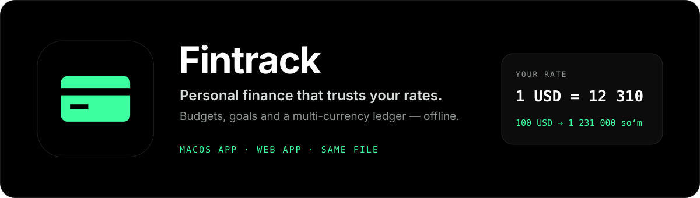
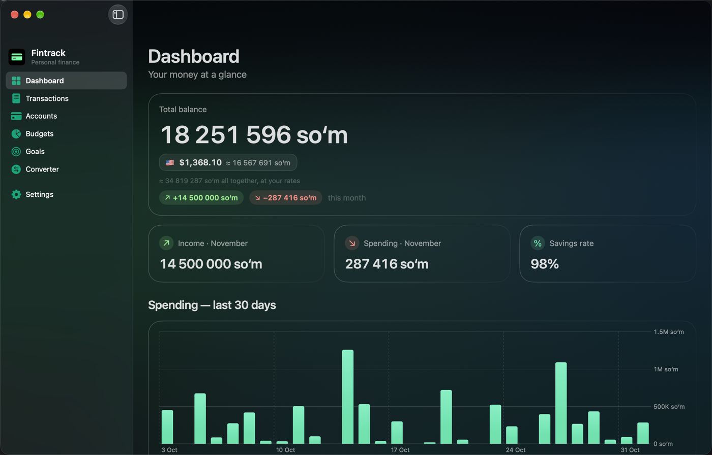
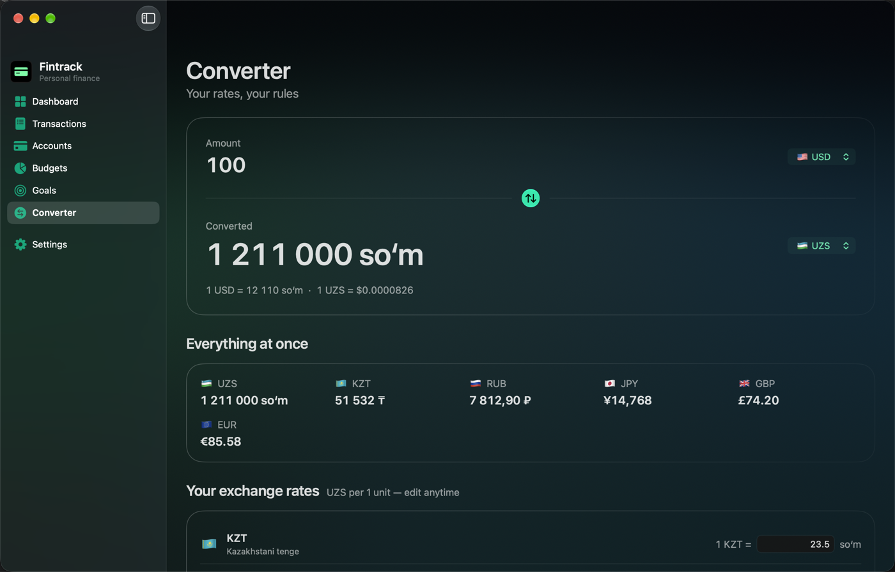
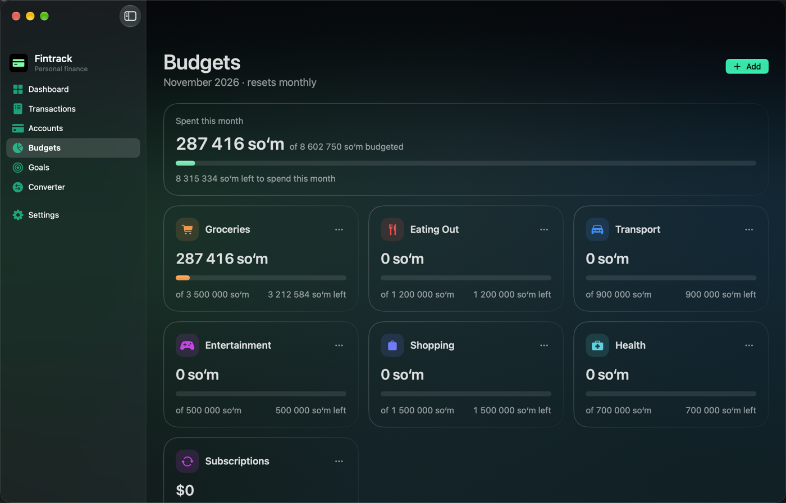
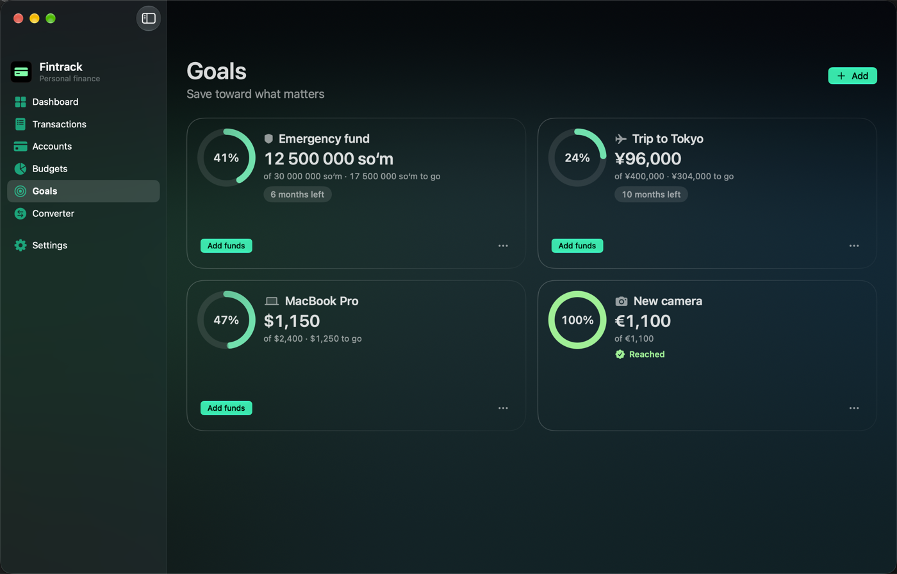
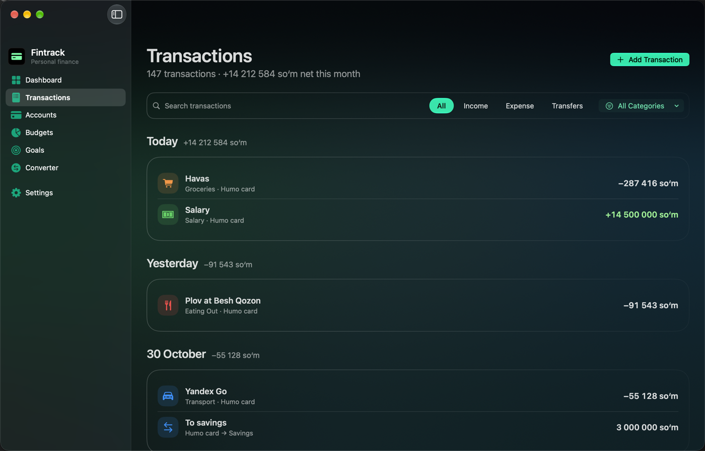
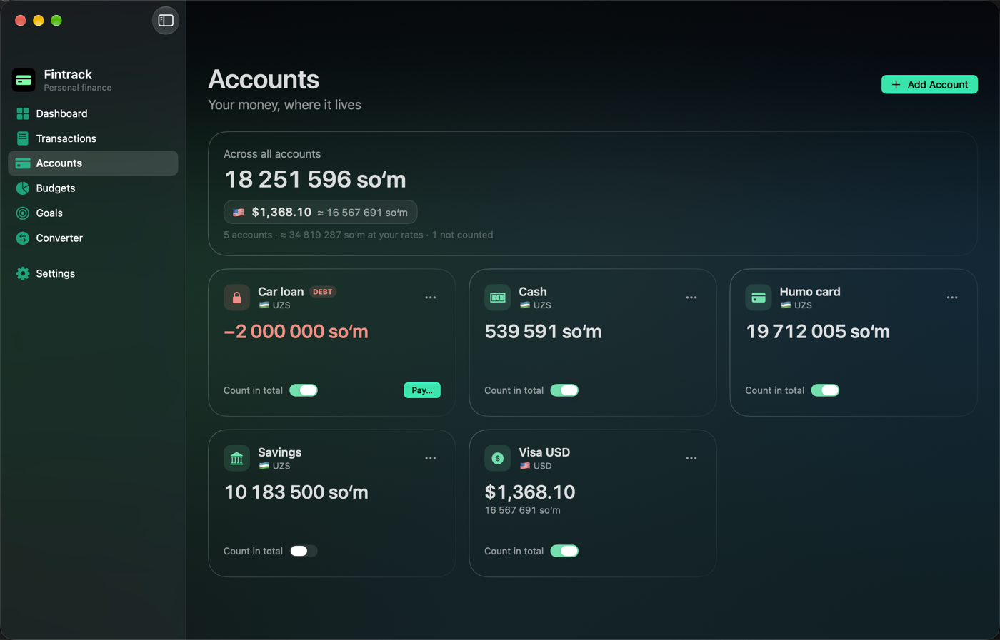

<h1 align="center">
  
</h1>

<p align="center">
  
</p>

Fintrack is a native macOS app for everyday money: a dashboard, a transaction
ledger, monthly budgets, savings goals and multiple accounts. Every entry keeps
the currency you actually paid in; totals roll up in the one you think in —
soʻm by default. Built with SwiftUI and the macOS 26 **Liquid Glass** design
language — the dark glass theme is shown here; a quiet light theme matches.

Everything lives in one local JSON file. No account, no sync, no rate feed.

## Your rates, your rules

Most finance apps pull exchange rates from a server and quietly reprice your
money. Fintrack never fetches a rate. You type what the exchange office
actually gave you — `1 USD = 12 110 soʻm` — and every conversion in the app
crosses through UZS at exactly those numbers, until you edit them.

<p align="center">
  
</p>

Seven currencies: UZS, KZT, RUB, USD, JPY, GBP, EUR. The display currency for
the whole app switches in Settings.

## The rest of the app

<table>
  <tr>
    <td width="50%"><b>Budgets</b> — monthly limits with live progress and over-budget warnings, drawn from the built-in expense categories (no custom ones).</td>
    <td width="50%"><b>Goals</b> — savings goals with progress rings, deadlines and quick "add funds" in any currency.</td>
  </tr>
  <tr>
    <td></td>
    <td></td>
  </tr>
  <tr>
    <td><b>Transactions</b> — add, edit, search, filter by kind and category; entries grouped by day, each in its own currency. Transfers between your own accounts never count as spending; debt payments do.</td>
    <td><b>Accounts</b> — cards, cash, savings and debts, each in its own currency, with a "counted in total" switch per account.</td>
  </tr>
  <tr>
    <td></td>
    <td></td>
  </tr>
</table>

## In the browser

The same app, same rules, same file format — as a web app you can open on
any device: **https://neo-commits-rhyme.github.io/Fintrack/**

Data stays in that browser's storage. Move it between the Mac app and the
browser with **Settings → Data → Export / Import JSON**; the file is the
very same `fintrack.json` the Mac app keeps in
`~/Library/Application Support/Fintrack/`.

```sh
cd web
npm install
npm run dev               # http://localhost:5173
npm test                  # vitest suite for the core
```

Vite + React + TypeScript, no backend, no tracking. Deployed to GitHub
Pages by `.github/workflows/web.yml` on every push to `main`.

## In Telegram

The web app is also a Telegram Mini App. Opened inside Telegram it follows
Telegram's theme, uses its Back button and haptics, and mirrors your data to
your Telegram account's CloudStorage, so it follows you to Telegram on your
other devices (whole-file, last change wins). Opened in a plain browser,
nothing changes and nothing is loaded from Telegram.

Set it up once in [@BotFather](https://t.me/BotFather): `/newbot`, then
`/newapp` (or **Bot Settings → Menu Button**) with the web app's URL.

To try the Telegram behaviour without Telegram, run the dev server and open
`http://localhost:5173/?tgmock` — a stand-in with CloudStorage kept in
`localStorage`.

## Import a bank statement

Both apps read the card export (`.xlsx`) from your bank: **Transactions → Import…**, or
**File → Import Bank Statement…** (⇧⌘I) on the Mac. Every row appears with a suggested
category, and only what you leave ticked is saved. Cash deposits and card-to-card moves
with no recipient stay off until you decide, and importing the same file twice adds nothing.

## Run the Mac app

```sh
swift run                 # debug run
swift test                # 148 swift-testing tests against an isolated data dir
./scripts/make-app.sh     # build dist/Fintrack.app (release + icon + codesign)
```

Drag `dist/Fintrack.app` into `/Applications` to launch it from Spotlight.

Or open `Package.swift` in Xcode and hit Run. The `--seed` launch argument
replaces your data with the 3-month demo dataset shown in the screenshots.
Set `FINTRACK_DATA_DIR=/some/dir` to run against a different data file
(tests and side-by-side runs never touch your real one).

Requires macOS 26 (Tahoe) and the Xcode 26 / Swift 6.2 toolchain.

## Data

One file: `~/Library/Application Support/Fintrack/fintrack.json` — plain JSON
you can read, copy or version yourself. A fresh install starts empty; load the
demo dataset or erase everything in **Settings → Data**.
